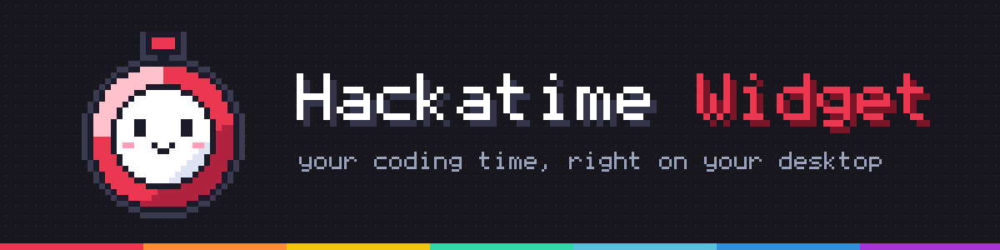

# Hackatime Widget

A small always-on-top desktop widget for Windows, macOS and Linux that shows your
[Hackatime](https://hackatime.hackclub.com) coding time: how much you coded, how much of it was AI-assisted,
your top languages, plus **sessions** (start/stop work blocks with streaks and history) and a **Pomodoro** timer.

It is a read-only client of Hackatime. Your editors keep sending heartbeats to Hackatime as they do today;
the widget only reads them back.

## Quick start

1. Download the latest build from the [**Releases** page](https://github.com/Thermo-flux/hackatime-widget/releases/latest) and run it:
   - **Windows**: `Hackatime-Widget-portable.exe` (no install, just double-click) or the `-setup.exe` installer (installs for your user, no admin needed).
   - **macOS**: the `.dmg` (Apple Silicon or Intel).
   - **Linux**: the `.AppImage` (`chmod +x` it and run), or the `.deb` / `.rpm`.
2. Open the widget. It connects in one of two ways:
   - **Automatic**: if Hackatime is already set up in your editor, the widget reads the key from your
     `~/.wakatime.cfg` (`%USERPROFILE%\.wakatime.cfg` on Windows). Nothing to do.
   - **Manual**: paste your API key. It is on the Hackatime setup page,
     <https://hackatime.hackclub.com/my/wakatime_setup>.
3. Use the tabs: **Stats**, **Sessions**, **Pomodoro**. The `×` hides the widget (it has no taskbar entry). Use the **tray icon** to bring it back: left-click toggles show/hide, right-click has *Theme*, *Launch at login* and *Quit*. The widget remembers where you left it, and a finished Pomodoro phase raises a native notification.

### Platform notes
| OS | Notes |
|---|---|
| Windows | Unsigned builds trigger SmartScreen: *More info → Run anyway*. Needs the WebView2 runtime (preinstalled on Windows 11). |
| macOS | Unsigned builds: right-click the app → *Open* the first time. |
| Linux | Needs `webkit2gtk-4.1` (`sudo apt install libwebkit2gtk-4.1-0`). On Wayland, compositors may ignore *always on top* and window dragging; X11 works fully. On Wayland the global hotkey and window positioning (compact mode, remembered position) may not work either; use the tray icon's *Compact mode* item and click the pill to expand. |

## Where your data lives
Next to the app if that folder is writable (portable use), otherwise in your user config folder
(`%APPDATA%\hackatime-widget`, `~/Library/Application Support/hackatime-widget`, `~/.config/hackatime-widget`).

| File | Contents |
|---|---|
| `config.json` | settings (below). Created when you connect with a pasted key. |
| `sessions.json` | your session history |
| `webview-data/` | the embedded browser's cache |

Override the location with `HACKATIME_WIDGET_CONFIG=/path/to/config.json`.

### `config.json`
Every field is optional; `{"api_key": "..."}` is a valid file.

| Field | Default | Meaning |
|---|---|---|
| `api_key` | `""` | Hackatime API key. If empty, `.wakatime.cfg` is used. |
| `base_url` | `https://hackatime.hackclub.com/api/hackatime/v1` | Same value as `api_url` in `.wakatime.cfg`; only the host part is used. Change for a self-hosted Hackatime. |
| `refresh_secs` | `300` | Stats refresh interval (minimum 30). |
| `mock` | `false` | Show built-in sample data instead of calling Hackatime. |
| `quiet_mascot` | `false` | The mascot only speaks when petted (also a toggle in the theme picker). |
| `compact_hotkey` | `CommandOrControl+Alt+Shift+H` | Global shortcut for compact mode. If it can't be registered (taken, or unsupported on Wayland) it is skipped and logged. |
| `pomodoro` | 25 / 5 / 15 min, long break every 4, `auto_start: false` | `focus_min` (1–180), `short_break_min` (1–60), `long_break_min` (1–90), `long_break_every` (0 = never, max 12), `auto_start`. Out-of-range values are clamped. The first three are set from the Pomodoro tab. |

Saving from the widget (a pasted key, timer lengths) rewrites `config.json` but keeps every other field.

## Pomodoro
The ring is the button: click it (or focus it and press Space / Enter) to start, pause and resume. The pill
under the time says what a click will do; while paused the time blinks slowly. **Reset** restarts the current
phase, **Skip** jumps to the next one without counting a focus session. The line under the buttons shows your
focus / rest lengths and how many focus sessions you finished; every 4th rest is a long rest.

**Times** opens the length settings: presets (25/5, 50/10, 90/20) and −/+ steppers for Focus, Rest and Long rest
(hold a button to repeat; or focus a value and use the arrow keys, Page Up/Down, Home/End, or the mouse wheel).
**Save** writes them to `config.json`, so they survive a restart; Esc or **Cancel** discards. If the timer hasn't
started, the new length shows at once. A started timer (running or paused) keeps its time, and the new lengths
take over from the next phase, or when you press **Reset** (the line then reads "Next: …").

## Sessions
Start and end a session from the Sessions tab. While one runs you get the clock, coding time, focus %
(share of the session spent coding), the human/AI split and the main project and language, taken from your
Hackatime heartbeats. When idle you see totals, average length, current and best streak, active days in the
last 14 and a 14-day chart. Sessions under 30 s are discarded. A session still running when the app closes
resumes on next launch (downtime counts toward its length). Without Hackatime access the session clock and
history still work.

## Themes and mascots
Press **Theme** (bottom right) to pick a look; the choice is remembered. There are 13: Classic, Avocado,
Tomato, Cat, Dog, Neon (futuristic drone), Frog, Ghost, Shroom, Boba, Terminal (green-screen CRT), Penguin and Jelly.
Each has its own palette, font and silhouette (cat ears, frog eyes, a ghost hem, a boba cup, a CRT bezel...) plus a
16×16 pixel mascot that reacts to what you're doing:
working with an AI-heavy or human-heavy day, a session running, Pomodoro focus or break, a streak, or Hackatime
being unreachable. Click the mascot to pet it. The speech bubble fades after a few seconds.

**Adding a theme.** Add an entry to `ui/js/themes/data.js`: a palette (`tokens`), a 16×16 `sprite` with a `legend`,
expression `patches` (blink, happy, sleepy, focus, sad), and optional speech `lines`. Small flourishes and
mascot poses go in `ui/css/skins.css` under `:root[data-skin="<id>"]`; the widget's outline (shape, decorations,
`--pad-*` gutters, content insets) goes in `ui/css/shapes.css` (see `design/shapes-brief.md`). Then run
`node tools/check-themes.mjs`, which checks sprite sizes, missing colours, text contrast (≥ 4.5:1), and that the
human and AI colours stay distinguishable, including for colour-blind users, and `node tools/shape-check.mjs`
(app running, see below), which hit-tests every button and text line in every theme and tab so nothing ends up
outside the shape.

## Troubleshooting
| You see | Meaning / fix |
|---|---|
| "Connect your Hackatime account" | No key found. Paste it, or run Hackatime's setup so `.wakatime.cfg` exists. |
| "Hackatime rejected that key" | Wrong or revoked key (HTTP 401/403). Copy it again from the setup page. |
| "Can't reach Hackatime" | Network down, or `base_url` is wrong. Press Retry. |
| Grey bar and "AI share unavailable" in Stats | The AI figure couldn't be fetched; the rest still works. |
| "Coding activity unavailable" in a session | Heartbeats couldn't be fetched; the clock and history still work. |
| Hover the red message | Full technical detail is in the tooltip. |

## How it talks to Hackatime
Checked against the official [hackclub/hackatime](https://github.com/hackclub/hackatime) `config/routes.rb` and
`swagger/v1/swagger.yaml`. Authentication is `Authorization: Bearer <api key>`.

| Used for | Endpoint |
|---|---|
| Totals, AI share, languages, projects | `GET /api/v1/users/my/stats` (ranges Day, 7d, 30d = the last 7 / 30 days including today, and All) with `start_date`, `end_date`, and `total_seconds=true`, `filter_by_category=ai coding`, or `features=languages,projects` |
| Live session activity | `GET /api/v1/my/heartbeats?start_time=&end_time=` |

Deliberately **not** used: `/api/hackatime/v1/users/current/summaries`. It always returns empty `categories`
and `languages`, and is capped at 366 days.

**Verification status.** `tools/probe-hackatime.mjs` prints the category names the live API uses (run it with `HACKATIME_KEY=<key>`); it still has to be run against the live service, and `AI_CATEGORY` is unconfirmed until then. Request shapes and error handling are tested against a local fake that follows the
swagger spec (`tools/fake-hackatime.mjs`). It has **not** yet been run against the live service, so the
exact `filter_by_category` spelling (`ai coding`) and the heartbeat fields are the first things to confirm
with a real key. If the AI call fails the widget shows a neutral bar and "AI share unavailable" rather than wrong numbers.

## Build from source
Prerequisites: [Rust](https://rustup.rs) and the [Tauri 2 prerequisites](https://v2.tauri.app/start/prerequisites/)
for your OS (Windows: MSVC Build Tools + WebView2; Linux: `libwebkit2gtk-4.1-dev libappindicator3-dev librsvg2-dev patchelf`).

```bash
cargo install tauri-cli --version "^2" --locked
cd src-tauri
cargo test          # 70 unit tests, no network needed
cargo tauri dev     # run the widget
cargo tauri build   # installers in src-tauri/target/release/bundle
```
`cargo tauri icon app-icon.png` regenerates all icon sizes from the source image.

Releases are built by `.github/workflows/release.yml` for all three OSes when you push a tag like `v0.1.0`.

### Layout
```
src-tauri/src/   api.rs (Hackatime client) config.rs sessions.rs activity.rs pomodoro.rs stats.rs error.rs
                 app.rs (Tauri commands, excluded from test builds)
src-tauri/fixtures/summaries_week.json   sample data for mock mode
ui/              index.html, css/{tokens,base,components,views,mascot,skins,shapes}.css,
                 js/{app,stats,sessions,pomodoro,mascot,themes,fit}.js, js/themes/data.js, js/lib/
tools/           dev helpers (below)
```

### Developer tools and flags
- `HACKATIME_WIDGET_MOCK=1` sample data; `HACKATIME_WIDGET_HIDDEN=1` keep the window off-screen for automated runs;
  `HACKATIME_WIDGET_NO_WAKATIME_CFG=1` don't read `.wakatime.cfg`; `HACKATIME_WIDGET_NO_WINDOW_STATE=1` don't remember
  the window position (the file lives in the OS config folder).
- `tools/probe-hackatime.mjs` lists the category names the live API reports (`HACKATIME_KEY=<key> node tools/probe-hackatime.mjs`).
- `tools/preview/moods.mjs` checks the mascot's mood and line against the data state (empty, no key, offline).
- `tools/fake-hackatime.mjs` local fake Hackatime (`PORT`, `KEY`, `FAIL_AI`, `FAIL_ALL`).
- `tools/smoke.mjs`, `tools/sessions-smoke.mjs`, `tools/e2e.mjs` drive the running window over WebView2's
  debug port (start the app with `WEBVIEW2_ADDITIONAL_BROWSER_ARGUMENTS=--remote-debugging-port=9222`, Windows).
- `tools/check-themes.mjs` validates theme data; `tools/theme-shots.mjs <dir> [320x436]` + `tools/contact-sheet.ps1`
  screenshot every theme on every tab into contact sheets; `tools/mood-shots.mjs` + `tools/mood-sheet.ps1` do the same
  for each mascot mood.
- `tools/shape-check.mjs [--native] [theme...]` checks that every theme's silhouette leaves all controls clickable and
  all text inside the card, on every tab, the live session, the API-key/error views and the theme picker. It runs at
  the real 320x436 window size by default; `--native` uses the hidden window's slightly smaller size as a stress test.
- `tools/preview/` runs the UI in a plain browser with a stubbed Tauri backend, so UI work can be checked on any OS
  without Tauri or WebView2. `node tools/preview/serve.mjs` serves it (open `http://127.0.0.1:4173/?scenario=zero`);
  scenarios are defined in `tools/preview/stub.js` (`normal`, `no_key`, `unauthorized`, `offline`, `zero`,
  `ai_unavailable`, `huge`, `session_live`, `sessions_empty`, `pomo_running`, `pomo_paused`, `pomo_break`, `mock`).
  `node tools/preview/shots.mjs out/` screenshots every scenario x theme x tab (320x436 @2x) and writes a contact
  sheet per scenario (`out/sheet-<scenario>.png`); `--scenarios`, `--themes` and `--tabs` narrow it. First run:
  `cd tools/preview && npm install && npx playwright install chromium`.
- `env.ps1` (Windows/PowerShell) points Rust, Cargo and temp files at a `D:\dev` folder.

Known limitation: the Windows/GNU toolchain used for local development can't build the `cdylib` crate type
(DLL export limit), so the library is `rlib` only; mobile targets would need it re-enabled.

## License
See [LICENSE](LICENSE).
